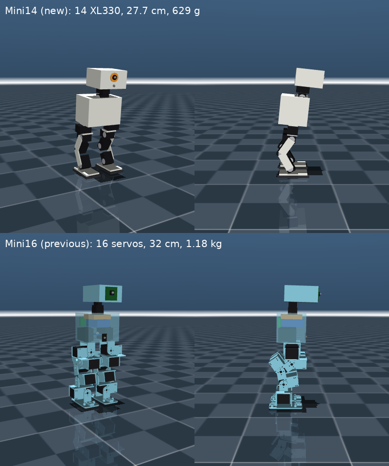

# Mini14: new design with what we learned from Microduck

Designed from scratch following [LESSONS.md](LESSONS.md): small servos, 5 per leg, a heavy
head as a counterweight and balance handled by RL. The model is generated with
`model/build_mini14.py` (all dimensions in one place).

| | Microduck | **Mini14** | Mini16 (previous) |
|---|---|---|---|
| Servos | 14 XL330 (+ beak) | **14 XL330-M288-T** | 12 STS3215 + 4 SCS0009 |
| Per leg | 5 | **5** (no ankle roll) | 6 |
| Neck/head | 4 | **4** (neck pitch, head pitch, yaw, roll) | 4 |
| Height | ~25 cm | **27.7 cm** | 32 cm |
| Mass | 737 g (model) | **629 g** | 1182 g |
| Weight in legs | 35 % | **41 %** | 62 % |
| Weight in neck + head | 38 % | **32 %** | 8 % |
| Hip pitch above the floor | 10 cm | **10 cm** | 12 cm |

## Decisions

- **Battery in the head** (2x 18650 + 2S BMS, 104 g): gives the head the mass that Microduck
  uses as a counterweight, without adding dead weight. The cables run through the neck.
- **Orange Pi Zero 3 in the torso**, standing upright against the back, so the torso stays low.
- **USB camera and 8x8 ToF on the front of the head** (like Microduck): they look where the head looks.
- **4 foot contact sensors** (toe and heel of each foot), already in the model.
- **80 x 42 mm foot** with a flat TPU sole.

## Servos: XL330 at 7.4 V

The model uses the parameters that the [BAM](https://github.com/Rhoban/bam) project measured on a
real XL330 (`params/xl330/m6.json`): maximum torque ~1.0 N·m at 7.4 V, stiffness with the factory
gain (P = 400) of ~1.2 N·m/rad, back-EMF braking and friction.

They are **soft**: under the robot's weight, the knees give way ~5°. That is why a fixed gait is not
enough (it barely moves forward and does not hold its heading) and balance is handled by RL, just like on
Microduck. The reference gait only takes steps without falling, correcting the tilt with the
ankle.

**Watch the voltage:** the XL330 datasheet says 3.7–6 V, but Microduck powers them
directly from 2S (it simulates 6.5–8.2 V). It is a known risk: more torque and speed in exchange for
service life. The safe alternative is a 6 V / 5 A regulator (with less torque).

## Components

| Qty. | Component | Mass | Approx. price | Notes |
|---|---|---|---|---|
| 14 | Dynamixel **XL330-M288-T** | 18 g each | ~40 € each in Europe (~27 USD in the US) | 20 x 34 x 26 mm, TTL bus, daisy-chained cables |
| 1 | **U2D2** (or half-duplex circuit with 74LVC2G241) | 9 g | ~32 USD | USB ↔ Dynamixel bus |
| 1 | **Orange Pi Zero 3** | 25 g | you already have it | 50 Hz control is plenty |
| 2 | High-drain 18650 (Molicel P30B) + holder + 2S BMS | 104 g | ~25 € | in the head |
| 1 | UBEC 5 V / 3 A | 10 g | ~4 € | for the Orange Pi |
| 1 | **BNO055** IMU | 3 g | | in the torso |
| 1 | **VL53L5CX** ToF | 2 g | 15–25 € | in the head |
| 1 | Compact USB camera | 6 g | 10–20 € | in the head |
| 4 | SS-10 microswitches | 1 g each | ~1 € each | toe and heel |
| — | 1000 µF capacitor, switch, XT30, cables | ~20 g | ~10 € | |

**Approximate total:** ~650 € in Europe (the servos, ~560 €, are ~85 %). An STS3215 costs
~25 € in European shops, so each XL330 is ~60 % more expensive. Alternative in the same class:
Feetech STS3032 (20 g), but it costs almost the same (~30–40 €) and has less torque (0.44 N·m at 6 V).

## Weights (model)

| Group | Mass |
|---|---|
| 14 XL330 | 252 g |
| Battery + holder + BMS (head) | 104 g |
| Torso electronics | 70 g |
| Head sensors | 8 g |
| Plastic (torso 45 g, head 30 g, legs 112 g, neck 8 g) | 195 g |
| **Total** | **629 g** |

## Result with RL

Short training run (2 M steps, 23 min on CPU, flat floor). The RL policy moves the 10 leg joints
and the 4 head joints. Evaluated in 20 trials with random variations and pushes:

| | Reference gait | With RL |
|---|---|---|
| Trials without falling and moving forward ≥ 30 cm | 0 % | **100 %** |
| Mean forward distance in 10 s | −1 cm | **72 cm** (~7 cm/s) |

Video: [media/mini14_rl_flat.mp4](media/mini14_rl_flat.mp4). Policy: `rl/policies/mini14_flat.onnx`.

## To do

- Train with ramps, steps and turn commands (longer: the PC with the NVIDIA GPU is a better fit).
- Design the parts in OpenSCAD with the real XL330 dimensions, as was done for Mini16, and
  regenerate the model from the CAD.
- Measure a real XL330 with BAM (or use its published parameters) before moving to the robot.
