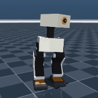
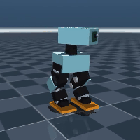
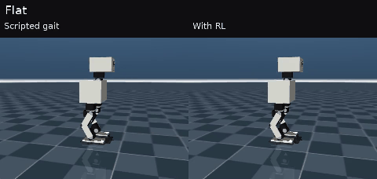
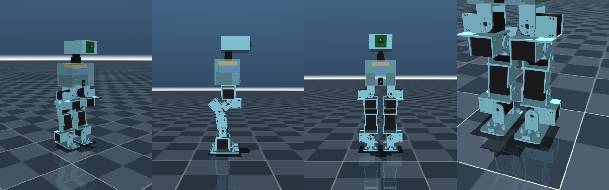

# Daruma

Small Microduck-style bipeds. Like the Japanese doll that always gets back up
(*nanakorobi yaoki*: "fall seven times, stand up eight").

## Small Microduck-style bipeds — exploration in simulation (MuJoCo)

Design exploration of a compact, low-cost biped, inspired by Open Duck Mini v2
and Microduck. There are two variants that share the same simulation, gait and RL code:

| | **Mini13** | **Mini16** (default, recommended) |
|---|---|---|
| Motors | 13: 5 per leg + 3 head | 16: 6 per leg + 4 head |
| Leg | hip yaw/roll/pitch, knee, ankle pitch | same + **ankle roll** |
| Height / mass | ~27 cm / 996 g | ~32 cm / 1.18 kg (real CAD parts) |
| Foot | curved TPU sole (toe, heel, sides) | flat |
| Camera | yes (simulated) | USB camera on the front of the head |
| Sensors | IMU, foot contact | IMU, 4 foot contact (toe/heel), 8x8 ToF looking at the floor |
| Speed on flat (scripted gait) | ~5 cm/s | ~3.4 cm/s |
| Ramps (scripted gait) | no | 10° yes, 15° no |
| Steps ≥ 1 cm | no (needs RL) | no (needs RL) |

<p>


</p>

Videos: [Mini13 walking](media/mini13_walk.mp4) · [Mini13 turning](media/mini13_turn.mp4) ·
[Mini16 walking](media/mini16_walk.mp4) · [Mini16 turning](media/mini16_turn.mp4) ·
[Mini16: what the camera sees](media/mini16_camera.mp4)

## New: Mini14 (recommended)

Designed from scratch with what we learned from Microduck ([LESSONS.md](LESSONS.md)):
14 XL330 servos (5 per leg + 4 in the neck and head), battery in the head as a counterweight,
27.7 cm and 629 g. Details, components and weights in **[MINI14.md](MINI14.md)**.

After a short RL training run (2 M steps, 23 min on 4 CPU cores, flat floor only) it
walks in **100 % of 20 trials** with randomized friction, mass, servo stiffness and delay,
plus pushes: ~7 cm/s. Without RL, the reference gait does not move forward.



[Video](media/mini14_rl_flat.mp4) · exported policy: `rl/policies/mini14_flat.onnx`

```bash
cd model && python build_mini14.py          # regenerates the model from its dimensions
cd ../rl && python train.py --robot mini14 --terrain flat --steps 2000000 --out runs/mini14_flat
python evaluate.py --robot mini14 --terrain flat --policy policies/mini14_flat.onnx
```

## Printable parts (CAD)

The Mini16 leg is already designed in OpenSCAD with the real STS3215 dimensions:
**[cad/README.md](cad/README.md)** (parts, materials, fasteners, collision-free ranges).
The simulation model `model/mini16.xml` is **generated** from the CAD (`cad/build_mjcf.py`),
so it uses the same distances, meshes and masses as the parts to be printed.



**What changed when using the real parts:** the robot went from ~24 cm / 1.10 kg (idealized
model) to ~32 cm / 1.18 kg, and the scripted gait became considerably more fragile (it climbs
10° ramps, no longer 15°). For uneven terrain, RL is necessary again.

## Conclusions of the exploration

- **Short legs with the knee bending backwards** walk much more stably than long or straight legs.
- **Without ankle roll (5 motors per leg, like Open Duck):** when the weight shifts onto one leg the
  foot tilts, so the scripted gait can only lift the foot ~1 cm. It walks well on
  flat ground, but any edge (a ramp or a 3–5 mm step) destabilizes it. Uneven terrain
  depends on RL training, which is exactly what Open Duck and Microduck do.
- **With ankle roll (6 per leg):** it lifts the foot 2 cm and climbs 10–15° ramps without RL. It costs
  2 servos and ~100 g more.
- **Waist roll** instead of ankle roll: helps little (only ~30 % of the weight is above it).
- **Steps of 1 cm or more:** no fixed gait gets over them; the robot has to react to the edge (RL +
  a distance sensor looking at the floor).
- **Heading control with the IMU** (BNO055): necessary on Mini13, whose open-loop heading is
  chaotic. With it, it walks straight (±15–20° sway) and turns at the requested rate.
- **RL:** the training environment works end to end (including ONNX export),
  but short training runs (0.5 M steps, ~8 min on CPU) barely improve: a real result
  requires much longer training, ideally on a GPU.

All tests respect the STS3215 limits (99th-percentile torque < 1.3 N·m out of 1.9 N·m,
commanded speed < 4.5 rad/s) and tolerate friction 0.5–1.3, +150 g and softer or stiffer servos.

## Mini13 design (per the project specification)

```
          ┌───────────┐
          │  head   ◉ │  camera; neck pitch + head pitch + head yaw
          └─────┬─────┘
            ┌───┸───┐
            │ torso │     2S battery at the bottom, board, IMU near the center of mass
            └┬─────┬┘
      hip    ●     ●      yaw + roll + pitch
            ╱       ╲     thigh 5.5 cm
      knee  ●       ●     bends backwards, range ~130°
             ╲     ╱      shin 6 cm
      ankle   ●   ●       pitch
            ◖▬▬▬◗ ◖▬▬▬◗   foot 8.6 x 5 cm, curved TPU sole, contact sensor
```

- Body tree `torso → hip_yaw_link → hip_roll_link → thigh → shin → foot`, with the origin of
  each body on the real servo axis (compatible with onshape-to-robot).
- Each servo is modeled as a separate part with its real mass (55 g), not by density.
- Pending for the CAD stage: dual-axis brackets with bearings (683/MR105), M3 inserts,
  2 mm walls, 0.3–0.4 mm clearances, cable pass-throughs for the full knee range and
  a thrust bearing in the hip yaw.

## Usage

```bash
pip install -r requirements.txt
cd sim
python run_demo.py                      # Mini16: simulates and prints results
python run_demo.py --robot mini13       # Mini13 (5 motors per leg)
python run_demo.py --video robot.mp4    # records a video (on a server: MUJOCO_GL=osmesa or egl)
python run_demo.py --viewer             # interactive 3D viewer (needs a display)
python run_demo.py --turn 0.2           # turns left at 0.2 rad/s (negative = right)
python -m pytest -q                     # tests
```

RL training (optional; see `rl/env.py` for observations, rewards and randomization):

```bash
pip install -r requirements-rl.txt
cd rl
python train.py --robot mini13 --steps 500000 --out runs/test
python evaluate.py --robot mini13 --policy runs/test/policy.zip
python export_onnx.py runs/test/policy.zip policy.onnx
```

Files:
- `model/mini13.xml`, `model/mini16.xml` — robots; `model/scene_*.xml` — robot + floor
- `sim/robots.py` — dimensions and gait parameters of each robot
- `sim/gait.py` — scripted gait, inverse kinematics and heading control
- `sim/common.py`, `sim/terrain.py` — simulation, metrics, ramps and steps
- `rl/` — Gymnasium environment, PPO training, evaluation and ONNX export

## Board for the robot

The RL network is small (2 layers of 128): any board runs it at 50 Hz. Chosen for Mini16:
**Orange Pi Zero 3** with a USB camera (the torso measures 7 x 8 x 6.2 cm).

| Board | Fits? | Notes |
|---|---|---|
| Orange Pi Zero 3 / Zero 2 | yes | no camera connector: use a USB camera |
| Raspberry Pi Zero 2W | yes | the easiest to fit; CSI camera connector |
| Orange Pi 5 Pro | no | powerful, but needs a bigger torso and more battery |

## What to learn from Microduck and Open Duck

See **[LESSONS.md](LESSONS.md)**: mass distribution, servos, head as a counterweight and training.

## Components

Full list for Mini16 (servos, board, battery, sensors, wiring, weight and what to check):
**[COMPONENTS.md](COMPONENTS.md)**. Approximate total: ~270–330 € without the board.

## Limitations

- The servo gains are estimates: they must be measured on a real servo (e.g. with
  [BAM](https://github.com/Rhoban/bam)) before moving to the real robot.
- The legs do not collide with each other in the simulation.
- The feet and parts are simple shapes (boxes and capsules), not the final CAD.
